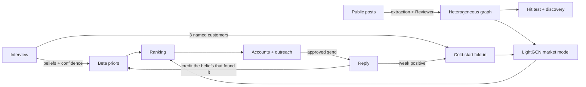

# Intuition in a bottle

A go-to-market engine that starts from the founder's instinct and lets market data correct it.

Early-stage companies have two weak data sources. Their own data is a handful of customers (typically 5–50), while commercial lead scoring needs roughly 50–1,000+ outcomes before it learns anything. Public data is broad but shows who *could* buy, not who *will*. In graph terms, the startup is a new node with almost no edges: a cold-start link-prediction problem in which its future customers are rarely near anything it has touched.

The founder's judgment about who buys and why is the strongest signal they have, but founders are also often wrong about their customer segment. This project treats that judgment as a **revisable prior**, tests it against a **heterogeneous market graph**, and **updates** it as replies come in, so the data can overrule the founder where they are wrong.

**Live demo:** https://kritcs.github.io/gtm/

> **Demo data is simulated.** There was no time to pull and train on the real HN corpus during the hackathon. Only the post *text* leaves the simulator. The extraction, the Reviewer, LightGCN, the cold start, the stats and the backtest all run for real on that text. ***We hope to update this repo as fast as possible once we finish training our dataset. We will improve and maintain this dataset overtime.*** 

## Architecture



The loop has four parts.

### 1. The founder as the prior (`api/bottle/interview.py`)

A four-question, story-first interview pulls out beliefs about pain, triggers, buyers and segments, and resolves the customers the founder names. Each belief is a Beta-distributed trust `q ~ Beta(α, β)`, and the founder's wording sets the prior:

| Wording | Prior | Mean |
|---|---|---|
| "every", "always", "exactly" | Beta(8, 2) | 0.80 |
| plain statement | Beta(4, 2) | 0.67 |
| "maybe", "sometimes", "I think" | Beta(2, 2) | 0.50 |
| found in market data, not said | Beta(1, 1) | 0.50 |

A confident belief carries more pseudo-counts, so a single reply moves it less than it moves a hunch.

### 2. The market as a heterogeneous graph (`api/market/`)

- **Extraction:** a dictionary pass with a negation filter ("migrating off X" is not adoption), plus a deliberately noisy LLM-style pass. Every candidate triple must cite the post span it came from, and a **Reviewer** rejects triples that are unsupported or negated before they enter the graph.
- **Typed nodes and edges:** companies, tools, hiring and pain signals, and posts. `ADOPTED` and `HAS_FEATURE` edges each carry a dated `post_id`, so every edge is a receipt.
- **Leakage safety:** `snapshot(asof)` returns the graph as it was on a date, and every training-side table is built from it. `to_cypher()` exports to Neo4j.

### 3. Learning from thin data (`api/ml/`)

- **Market model:** LightGCN trained with BPR, written in NumPy. Propagation is linear (`E = M·E0`), so the gradient is exactly `Mᵀ·∂L/∂E`. The founder's product is held out of training.
- **Cold start:** a new product with three customers can't be trained directly. A ridge map turns its description into an initial embedding `e0`. A BPR fold-in on the named customers then adjusts it, with an L2 pull back toward `e0` (a MAP estimate), so three examples aren't memorized and there is no full retrain.
- **Text:** TF-IDF + LSA, plus a lexical channel through a random projection, which works like dense embeddings plus BM25. It matches the founder's pain description against every company's own posts.

### 4. Insight, ranking and feedback (`api/insight/`, `api/gtm/`, `api/engine.py`)

- **The hit:** finds a trait the founder's customers share that the founder never mentioned. Each feature's base rate comes from companies matched on size, stage and calendar window, not the whole market. A Poisson-binomial tail gives the p-value, Benjamini–Hochberg corrects across every feature tested, and the lift is shrunk with a Beta prior because n is tiny.
- **Discovery:** k-means segments. It keeps the top fifth by fit to the product, then picks the segment farthest from the founder's experience, and requires at least 8 companies with their own quotes.
- **Ranking:**

  `s(c) = pct(ŷ(c)) + λ(c)·w·pct(s_founder(c))`, where `λ(c) = λ0·exp(−d(c, E)/τ)`

  Both terms are converted to percentiles because one is a BPR score and the other a cosine. `λ` decays with distance from the founder's experience `E`, so their instinct counts most where they have first-hand knowledge. The weight `w` scales with how much the founder's pain beliefs are currently trusted. A signal found in the data, like the RevOps hire, boosts accounts in proportion to its own trust.
- **Outreach:** drafts in the founder's voice, an AI-phrasing check, and an approval gate. Nothing sends without a click. The voice model (LoRA + DPO on the founder's own writing) is the designed path; in this build the fine-tune is a simulation.
- **Feedback:** a reply credits only the beliefs that found that account: the trigger if the account showed it, the pain belief if its post matched, and the buyer the email went to (`α += 1`). The reply is recorded as an outcome, the account is folded in as a positive, and the list re-ranks.

### Agents and integrations

Each step (interviewer, extractor, Reviewer, market model, ranker, writer, webhook) runs as an agent and emits events over SSE. With keys set, the same events post to a **Band** room, and paid enrichment is metered as usage events in **Flexprice** against a prepaid wallet, spent in order of score ÷ cost. Without keys, the payloads are mirrored locally.

| Env var | Effect |
|---|---|
| `BAND_API_KEY` (+ `BAND_CHAT_ID`) | Posts each agent step to a Band room (`POST /api/v1/agent/chats/{id}/events`). |
| `FLEXPRICE_API_KEY` (+ `FLEXPRICE_BASE_URL`, `FLEXPRICE_EVENT_NAME`) | Creates a customer and prepaid wallet per session and ingests an `account_enrichment` event per lookup. |
| `RESEND_API_KEY` + `DEMO_SEND_TO` (+ `RESEND_FROM`) | Approved emails really send, redirected to a test inbox. |

## Proof (simulated market, seed 7)

Train through 2024-12, then predict which of 724 companies adopt Ledgerlight afterwards (69 did). Recall@50, with 95% bootstrap CIs:

| Method | Recall@50 | 95% CI |
|---|---|---|
| random (expected) | 0.069 | — |
| popularity | 0.087 | 0.029 to 0.159 |
| description match (LLM stand-in) | 0.043 | 0.000 to 0.087 |
| market model alone | 0.101 | 0.043 to 0.188 |
| founder alone | 0.029 | 0.000 to 0.072 |
| **market + founder** | **0.145** | 0.072 to 0.232 |

The combination beats both parts on the point estimate, but the intervals overlap, and the UI says exactly that. Most 2025 adopters come from the logistics shift, which neither the market history nor the founder's gut anticipated. That shift is what the discovery card exists to surface.

`sim/build.py` (`make sim`) also runs, on the same synthetic market: LightGCN against an ALS baseline, a `logit(founder prior) + correction` model fit by IRLS across a time split, and Thompson sampling with founder priors. Results are in the app's Results tab.

## From hackathon build to research method

The demo proves the loop works end to end. Several of its pieces are hand-set heuristics, and the follow-up research in [`research/`](research/) replaces each with something principled. The use case stays the same.

| Demo (this build) | Problem with it | Research version |
|---|---|---|
| Founder wording sets fixed Beta pseudo-counts | Founders are overconfident in ways their wording doesn't reveal; nothing learns how far to trust them | Calibrated founder prior `logit p = a + b·logit(m)`, with trust `(a, b)` learned from outcomes and pooled across segments, so 5–50 labels are enough |
| Ranking blends percentiles with a hand-set weight `λ(c)` | A fixed weight lets a wrong founder dominate forever | A Bayesian posterior over the market graph centred on the founder prior; the founder's weight per account falls as nearby labels arrive |
| A reply credits beliefs with `α += 1` | Outreach is chosen *by* the prior, so labels are biased toward segments the founder already likes, and a wrong belief about an avoided segment is never tested | Logged contact propensities, a minimum exploration rate, and a selection-aware positive-unlabeled loss |
| LightGCN plus a cold-start fold-in | The new seller has almost no edges, so graph propagation from it carries little signal | Graph structure on the account side; segment-level scoring carries the founder signal |
| One backtest, seed 7, overlapping CIs | Can't show *when* the founder helps | Simulated sweeps over founder reliability, label count and exposure bias, starting with a sanity check that an oracle founder must help |

The end goal is a model pretrained on many simulated markets and founders that learns in context how much to trust a new founder. See [`research/PLAN.md`](research/PLAN.md) and [`research/docs/research-map.md`](research/docs/research-map.md).

## Honest limits
- Founder trust is set by wording, not learned, and outreach selection bias is not corrected (see the table above).
- The market is simulated. Swapping in the real corpus means replacing `simulate.generate()` with a loader for `brusic/hacker-news-who-is-hiring-posts` (updated 2026-11-21). The post → triple → graph path stays the same.
- The interviewer and extractor are rule-based, so they're deterministic and run offline. A Claude-backed extractor can be added behind the same `absorb()` interface.
- The "LLM baseline" is a description-match stand-in. A real LLM baseline must only be scored on months after its training cutoff.

## Code map

| Path | What |
|---|---|
| `api/bottle/` | Interview, belief extraction, Beta priors |
| `api/market/` | Simulator, extraction, typed graph with `snapshot(asof)` |
| `api/ml/` | Text model, LightGCN, cold start, backtest, ALS |
| `api/insight/` | Hit test, discovery, ranking, stats |
| `api/gtm/` | Reviewer, accounts, outreach |
| `api/integrations/` | Band and Flexprice clients |
| `api/engine.py`, `api/main.py` | Session state and agents; FastAPI + SSE |
| `apps/web/` | UI (vanilla JS, three.js, no build step) |
| `scripts/build_static.py` | Records the demo flow for the static GitHub Pages copy |
| `research/` | Follow-up research: plan, research map, simulator and principled baselines |

## Run it

```bash
uv sync
uv run uvicorn api.main:app --port 8000   # http://localhost:8000
uv run pytest -q
make sim                                  # training runs for the Results tab
make pages                                # rebuild and publish the static demo
```
